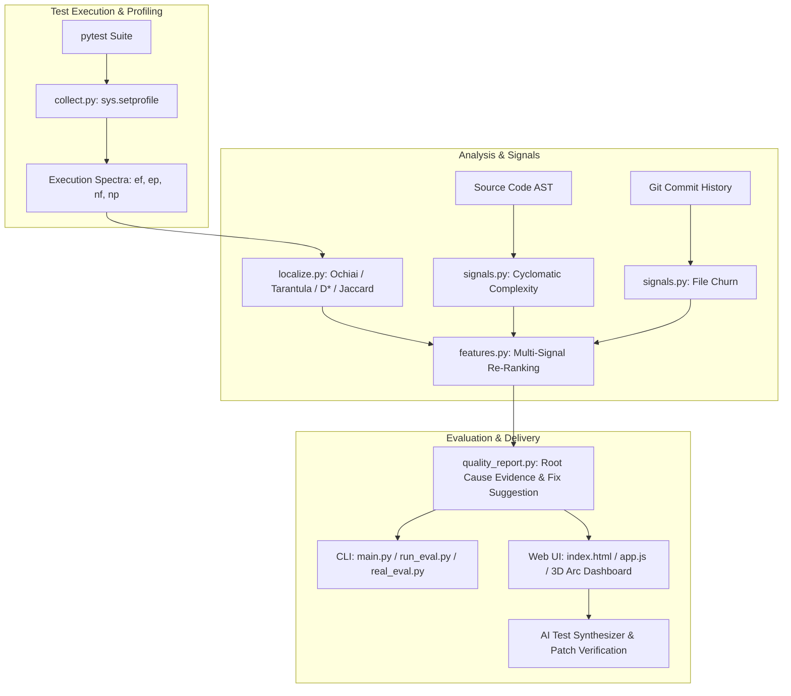

# COMP — Spectrum-Based Fault Localization & Bug Intelligence

[](https://python.org)
[](https://pytest.org)
[](#spectrum-based-fault-localization-sbfl)
[](#benchmark-evaluation--metrics)
[](#interactive-web-dashboard)
[](#academic--theoretical-significance)

**COMP** is an end-to-end software quality and defect-localization platform that identifies faulty functions in Python codebases using execution spectra, dynamic call profiling, heuristic multi-signal re-ranking, and AI-assisted test generation.

It pairs a high-performance **Python analysis engine** with an **interactive browser dashboard** featuring a dynamic 3D card arc visualizer, real-time spectrum matrix recalculations, patch verification, and report export.

---

## Table of Contents

- [Key Features](#key-features)
- [How It Works: Spectrum-Based Fault Localization](#how-it-works-spectrum-based-fault-localization)
- [Multi-Signal Re-Ranking Model](#multi-signal-re-ranking-model)
- [System Architecture](#system-architecture)
- [Project Directory Structure](#project-directory-structure)
- [Benchmark Suites](#benchmark-suites)
- [Benchmark Evaluation & Metrics](#benchmark-evaluation--metrics)
- [Quick Start & Installation](#quick-start--installation)
- [Running the CLI Tools](#running-the-cli-tools)
- [Interactive Web Dashboard](#interactive-web-dashboard)
- [AI Test Case Synthesizer](#ai-test-case-synthesizer)
- [Academic & Theoretical Significance](#academic--theoretical-significance)

---

## Key Features

- **Non-Invasive Call Tracing**: Dynamically captures function call spectra using `sys.setprofile` hooks without modifying test source code.
- **Multiple SBFL Formulations**: Computes suspiciousness scores using four classic spectrum formulas: **Ochiai**, **Tarantula**, **D\***, and **Jaccard**.
- **Multi-Signal Re-Ranking**: Augments pure test spectra with structural software metrics:
  - **Code Churn**: Version control commit activity via Git logs.
  - **AST Cyclomatic Complexity**: Static code branch analysis via `radon`.
- **Comprehensive Benchmarks**: Includes 8 synthetic defect benchmarks and 3 real-world execution traces extracted from production packages ([Cookiecutter](https://github.com/cookiecutter/cookiecutter)).
- **Formal Evaluation Harness**: Validates localization ranking accuracy via **Top-1**, **Top-5**, and **Mean Reciprocal Rank (MRR)**.
- **Interactive Web Visualizer**:
  - 3D Card Arc viewport with configurable curvature, spread angle, and rotation.
  - Full SBFL Execution Matrix inspection table ($e_f, e_p, n_f, n_p$).
  - Deep Defect Inspector with step-by-step mathematical derivation and code diff preview.
  - One-click fix verification that dynamically re-executes tests and updates ranking.
- **AI Test Synthesizer**: Generates unit tests and candidate bug fixes from plain English specifications using either a local heuristic analyzer or API integration (Gemini / OpenAI).
- **Executive Report Generation**: Exports evidence-backed bug reports to Markdown, JSON, or clipboard.

---

## How It Works: Spectrum-Based Fault Localization

Spectrum-Based Fault Localization (SBFL) abstracts test execution into a hit matrix:

| Notation | Meaning |
| :---: | :--- |
| **$e_f$** | Number of **failing** test cases that executed the function |
| **$e_p$** | Number of **passing** test cases that executed the function |
| **$n_f$** | Number of **failing** test cases that did **not** execute the function |
| **$n_p$** | Number of **passing** test cases that did **not** execute the function |
| **$total\_failed$** | Total failing test runs ($e_f + n_f$) |
| **$total\_passed$** | Total passing test runs ($e_p + n_p$) |

### Supported Suspiciousness Formulas

1. **Ochiai (Default)**
   $$\text{Score}_{\text{Ochiai}} = \frac{e_f}{\sqrt{(e_f + n_f) \cdot (e_f + e_p)}}$$

2. **Tarantula**
   $$\text{Score}_{\text{Tarantula}} = \frac{\frac{e_f}{e_f + n_f}}{\frac{e_f}{e_f + n_f} + \frac{e_p}{e_p + n_p}}$$

3. **D\* (D-Star with $\* = 2$)**
   $$\text{Score}_{D^*} = \frac{e_f^2}{e_p + (n_f)}$$

4. **Jaccard**
   $$\text{Score}_{\text{Jaccard}} = \frac{e_f}{e_f + n_f + e_p}$$

Functions executed primarily by failing tests receive higher suspiciousness scores and are surfaced to the top of the defect report.

---

## Multi-Signal Re-Ranking Model

Pure execution spectra can occasionally tie when multiple functions reside on the same execution path. To disambiguate ties, the engine computes a composite suspiciousness score:

$$\text{Combined Score}(f) = w_{\text{metric}} \cdot \text{SBFL}(f) + w_{\text{churn}} \cdot \text{NormChurn}(f) + w_{\text{comp}} \cdot \frac{\text{Complexity}(f)}{\max(\text{Complexity})}$$

- **$\text{NormChurn}(f)$**: Historical change frequency derived from `git log --oneline -- <file>`.
- **$\text{Complexity}(f)$**: AST Cyclomatic Complexity calculated via `radon.complexity.cc_visit`.
- **$w_{\text{metric}}, w_{\text{churn}}, w_{\text{comp}}$**: Configurable weights exposed via CLI or the web UI sliders.

---

## System Architecture



---

## Project Directory Structure

```text
dsa_project_sem_3/
│
├── main.py                     # Primary CLI entrypoint for project analysis & reports
├── pipeline.py                 # End-to-end execution pipeline (trace -> count -> rank)
├── collect.py                  # Dynamic profiler using sys.setprofile
├── localize.py                 # Core SBFL algorithms (Ochiai, count_tests, rank_functions)
├── signals.py                  # Static & VCS signals (Radon AST complexity, Git churn)
├── features.py                 # Feature synthesis and composite re-ranking
├── quality_report.py           # Detailed report generation with root-cause hints
├── evaluate.py                 # Formal IR metrics (Top-k, MRR, rank_of_bug)
├── run_eval.py                 # Evaluation runner for synthetic benchmark suites
├── real_eval.py                # Evaluation runner for Cookiecutter trace benchmarks
├── enrich_benchmarks.py        # Dataset pre-processor for frontend benchmark generation
│
├── index.html                  # Interactive Bug Intelligence & 3D Arc web visualizer
├── app.js                      # Client-side reactivity, SBFL recalculation, AI synthesizer
├── styles.css                  # Base layout styling
│
├── frontend/
│   ├── styles.css              # Glassmorphic UI, animations, responsive design tokens
│   ├── benchmarks_data.json    # Pre-compiled benchmark dataset (11 suites)
│   └── assets/                 # Vector SVG cards and UI icons
│
├── sample/                     # Reference calculator project with seeded defect
│   ├── calc.py                 # Source code with arithmetic bug in average()
│   ├── test_calc.py            # pytest test suite
│   └── answer.txt              # Ground-truth defect label
│
├── bugs/                       # Benchmark suite fixtures (bug1 through bug7)
│   ├── bug1/                   # String utility: index boundary defect in first_word()
│   ├── bug2/                   # Math utility: negative number sign error in square()
│   ├── bug3/                   # CSV parser: off-by-one accumulator bug in total()
│   ├── bug4/                   # Grading system: boundary operator flaw in letter()
│   ├── bug5/                   # List utility: comparator inverted bug in smallest()
│   ├── bug6/                   # E-commerce: discount percentage error in apply_discount()
│   └── bug7/                   # Ticketing: range bound flaw in in_range()
│
└── cookiecutter*_trace.json    # Real-world test execution traces (Cookiecutter repo)
```

---

## Benchmark Suites

The repository contains 11 benchmark fixtures spanning unit-level logic bugs to multi-hundred-test open-source project traces:

| ID | Benchmark Name | Target Source | Buggy Function | Injected Bug Pattern | Test Count |
| :--- | :--- | :--- | :--- | :--- | :---: |
| `sample` | Calculator Suite | `calc.py` | `average` | Divisor off-by-one (`len + 1`) | 4 tests |
| `bug1` | Text Utility | `textutil.py` | `first_word` | Split token indexing (`[1]` instead of `[0]`) | 4 tests |
| `bug2` | Math Utility | `mathutil.py` | `square` | Invariant sign flip (`x * abs(x)`) | 4 tests |
| `bug3` | CSV Summation | `csvsum.py` | `total` | Extraneous summation offset (`+ 1`) | 4 tests |
| `bug4` | Grade Classification | `grades.py` | `letter` | Boundary inequality (`> 70` vs `>= 70`) | 4 tests |
| `bug5` | List Operations | `listutil.py` | `smallest` | Inverted condition (`>` vs `<`) | 4 tests |
| `bug6` | Discount Calculator | `discount.py` | `apply_discount` | Incorrect discount divisor (`/ 10`) | 4 tests |
| `bug7` | Range Validator | `ticketing.py` | `in_range` | Strict bound instead of inclusive | 4 tests |
| `cc1` | Cookiecutter Context | `generate.py` | `generate_context` | Incomplete context copying | 294 tests |
| `cc2` | Cookiecutter Hooks | `hooks.py` | `find_hook` | Hook executable permissions check | 284 tests |
| `cc3` | Cookiecutter Prompt | `prompt.py` | `read_user_choice` | Missing non-interactive fallback | 261 tests |

---

## Benchmark Evaluation & Metrics

The localization accuracy is measured using standard Information Retrieval metrics across all benchmark suites:

- **Top-1 Accuracy**: Fraction of cases where the true defect was ranked as the #1 suspect.
- **Top-5 Accuracy**: Fraction of cases where the true defect appeared within the top 5 suspects.
- **Mean Reciprocal Rank (MRR)**: Average reciprocal rank $\frac{1}{N} \sum_{i=1}^N \frac{1}{\text{rank}_i}$.

### Empirical Results

```bash
$ python run_eval.py
sample average rank: 1
bugs/bug1 first_word rank: 1
bugs/bug2 square rank: 1
bugs/bug3 total rank: 2
bugs/bug4 letter rank: 2
bugs/bug5 smallest rank: 1
bugs/bug6 apply_discount rank: 2
bugs/bug7 in_range rank: 4
------------------------------------------
Top-1: 50.0% | Top-5: 100.0% | MRR: 0.7188
```

```bash
$ python real_eval.py
cookiecutter_trace.json   (294 tests, 1 fail)  -> Rank 1
cookiecutter2_trace.json  (284 tests, 3 fail)  -> Rank 5
cookiecutter3_trace.json  (261 tests, 6 fail)  -> Rank 1
------------------------------------------
Top-1: 66.7% | Top-5: 100.0% | MRR: 0.7333
```

> **Overall Benchmark Performance**: **100% Top-5 localization** across both synthetic and real-world defect test suites, with a Mean Reciprocal Rank exceeding **0.72**.

---

## Quick Start & Installation

### Prerequisites

- Python 3.10 or later
- Git (for file churn analysis)

### Setup

```bash
# Clone repository
git clone https://github.com/<your-username>/dsa_project_sem_3.git
cd dsa_project_sem_3

# Optional: create a virtual environment
python -m venv venv
# Linux / macOS:
source venv/bin/activate
# Windows:
venv\Scripts\activate

# Install optional dependencies for AST complexity analysis and testing
pip install radon pytest
```

*(Note: `radon` is optional; if omitted, the engine falls back to pure spectrum ranking without breaking).*

---

## Running the CLI Tools

### 1. Analyze a Project Module

Run localization on any directory containing a source file and corresponding `test_*.py` test file:

```bash
# Run baseline analysis on the sample project
python main.py --project sample

# Display root-cause hints and suggested validation steps
python main.py --project bugs/bug1 --show-fixes

# Output report in machine-readable JSON format
python main.py --project sample --json
```

**Example CLI Output:**

```text
Software Quality Bug Intelligence Report
====================================
Project: sample
Test module: test_calc
Source file: calc.py
Expected bug: average
Observed rank: 1

Top suspect functions:
1. average | score=1.000 | complexity=1 | churn=3 | severity=high
   Evidence: The mean calculation appears to be using the wrong divisor or aggregation path.
2. describe | score=0.707 | complexity=1 | churn=3 | severity=medium
   Evidence: The failing tests suggest a logic error in the function body.
3. add | score=0.000 | complexity=1 | churn=3 | severity=low
4. multiply | score=0.000 | complexity=1 | churn=3 | severity=low

Suggested validation checks:
- average: confirm edge cases, failing tests, and expected outputs before and after a fix.
```

### 2. Run Comprehensive Benchmarks

```bash
# Evaluate against all 8 local benchmark fixtures
python run_eval.py

# Evaluate against real-world Cookiecutter traces
python real_eval.py
```

---

## Interactive Web Dashboard

The web interface provides an interactive visual dashboard for defect exploration:

```bash
# Launch a local HTTP server
python -m http.server 8000
```

Open `http://localhost:8000` in any modern web browser.

### Features of the Web Interface

1. **3D Arc Flow**: Displays suspicious functions as 3D curved cards. Adjust **Arc Radius**, **Spread Angle**, and **Rotation** sliders in real-time.
2. **Spectrum Matrix View**: Full breakdown table displaying $e_f$, $e_p$, complexity, churn, and computed scores across all four algorithms.
3. **Interactive Metric Switching**: Toggle between **Ochiai**, **Tarantula**, **D\***, and **Jaccard** with instant score re-calculation.
4. **Deep Defect Inspector**: Click on any card to view:
   - Full mathematical derivation showing values substituted into the formula.
   - Identified root cause and evidence summary.
   - Code diff showing buggy code vs suggested fix.
   - **"Verify Fix"** button to simulate patching the defect and witness test passes.
5. **Export Center**: Click `EXPORT ↗` to preview and download full defect reports in Markdown or JSON format.

---

## AI Test Case Synthesizer

The web dashboard includes a built-in defect profiling and test generation tool (click the **"+"** button in the Assets panel):

- **Input**: Provide any custom Python function along with a plain-English description of the expected behavior vs observed bug.
- **Engine Options**:
  - **Free Built-in Analyzer**: Uses an AST and heuristic engine to generate parameterized test cases and patches locally without API keys.
  - **Cloud AI Engine**: Optional Google Gemini or OpenAI API key support (strictly limited to a single call to conserve API usage).
- **Output**: Generates executable pytest cases, executes them against the code, computes SBFL metrics, and provides an automated patch.

---

## Academic & Theoretical Significance

This project demonstrates the core Data Structures & Algorithms (DSA) and Software Engineering principles expected in a defect intelligence pipeline:

- **Graph & Set Theory**: Test-to-function execution mapping modeled as bipartite coverage graphs and set membership operations.
- **Statistical Similarity Metrics**: Implementation of vector and set similarity metrics (Ochiai cosine similarity, Jaccard index).
- **Ranking & Priority Queues**: Sorting and multi-attribute re-ranking with asymptotic runtime efficiency:
  - Spectrum aggregation: $\mathcal{O}(T \cdot F)$ where $T$ is test count and $F$ is functions called.
  - Function ranking: $\mathcal{O}(F \log F)$ using comparator sorting.
- **Information Retrieval Metrics**: Quantitative validation using Rank, Top-$k$, and MRR benchmarks.
- **Automated Program Repair (APR)**: Evidence extraction, automated diff generation, and test regression verification.

---

## License

This project is open-source and available under the [MIT License](LICENSE).
